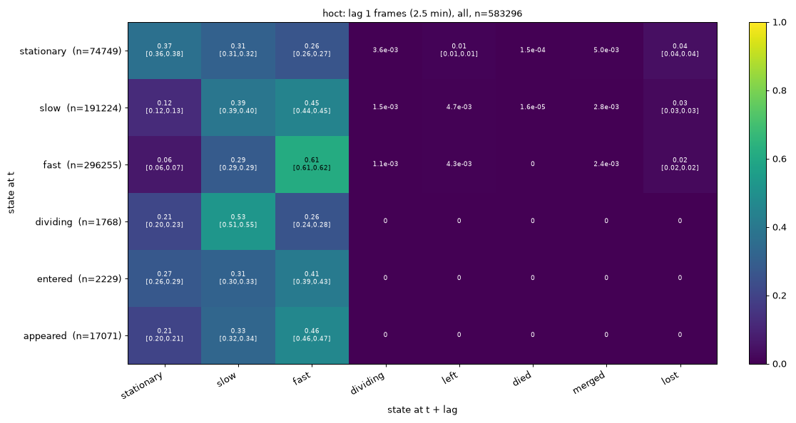
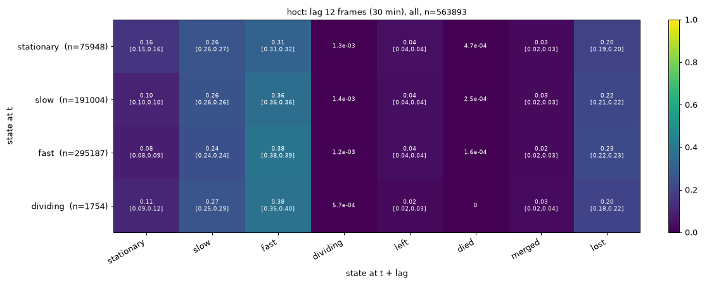
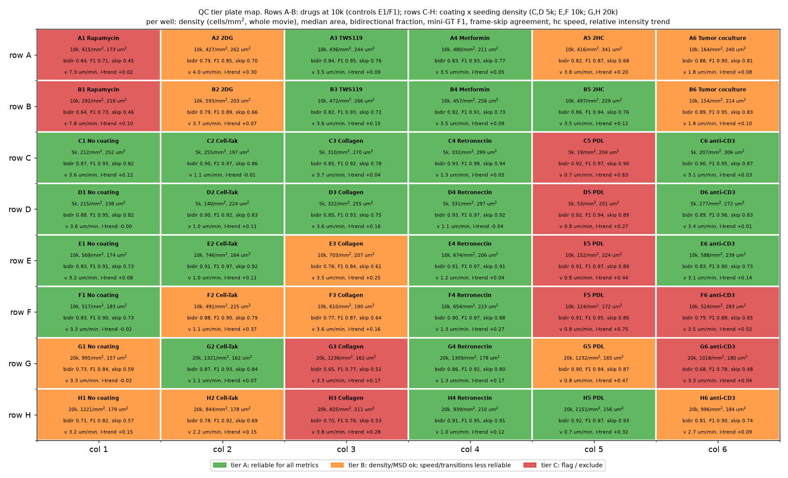
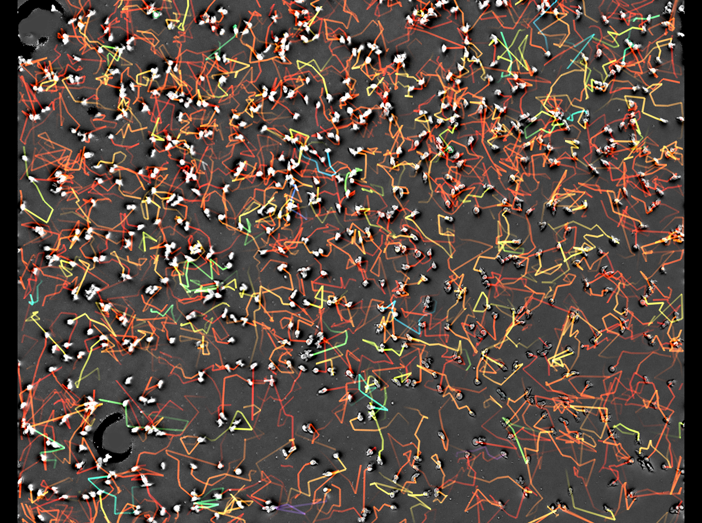
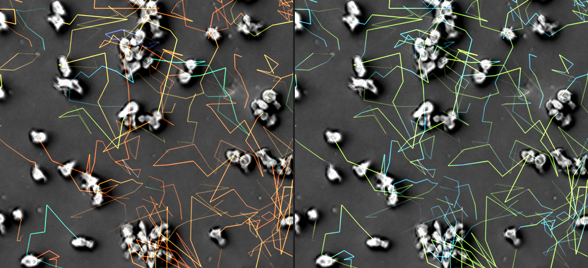
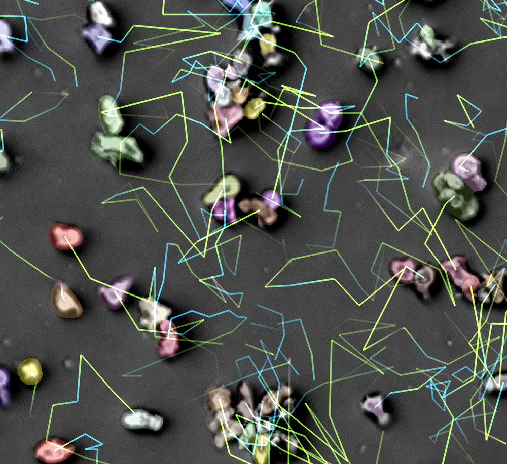
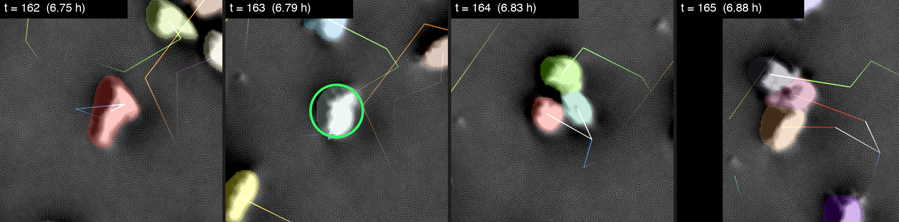
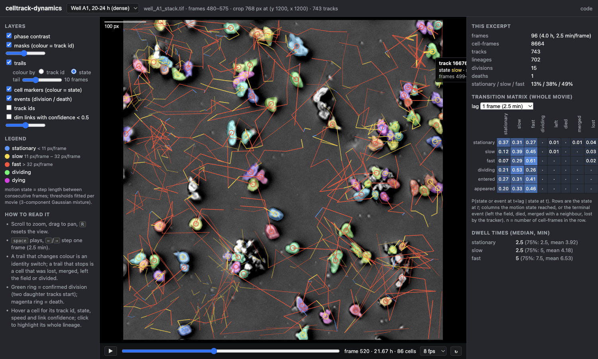
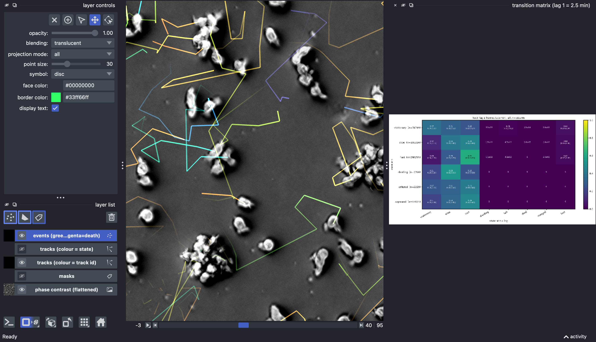

# celltrack-dynamics

Label-free cell tracking and state-transition analysis for low-frame-rate time-lapse microscopy.

Developed on `well_A1_stack.tif` of the Jurkat MCAM-well dataset and then run on all 48 wells of the
plate: 24 h label-free time-lapses (576 frames, 2.5 min interval, 3072 × 3072 px at 0.5 µm/px,
0.3 NA, 2.36 mm² field per well) in which cells migrate, divide, die and cluster. The goal is to track
every cell as well as the frame rate allows and to summarise the population as a
**state-transition matrix** (stationary / slow / fast / in-cluster / dividing / dying / left field),
with dwell times, event rates and an honest estimate of how reliable the tracking is; at plate level,
to compare those quantities across substrate coatings, seeding densities and drug treatments.

Main results: per movie `outputs/analysis/transition_hoct/report.html`; for the plate
[`docs/plate-analysis/report.md`](docs/plate-analysis/report.md) (§6), also at
https://wadduwagelab.com/demos/celltrack/plate/.

```
celltrack/           the pipeline (one CLI module per stage, see §2; plate.py aggregates wells, see §6)
demo/                browser viewer (demo/web, live at wadduwagelab.com/demos/celltrack) and napari demo (see §7)
docs/images/         screenshots used in this README
docs/plate-analysis/ 48-well plate analysis: report, five findings write-ups, figures, per-well tables and QC tiers (see §6)
configs/             default.yaml (laptop, Apple MPS) and wahab.yaml (ODU Wahab cluster, CUDA)
cluster/wahab/       Slurm job scripts, environment setup, data download and result sync for the Wahab cluster
data/                raw stacks      (git-ignored; see §9)
outputs/             all results     (git-ignored; outputs/wells/<well>/ per well, outputs/wells/plate/ plate tables)
```

## 1. The problem

Cells move a median of ~27 px between frames (up to >100 px), while the nearest-neighbour spacing
falls from ~68 px to ~42 px as the population doubles. Frame-to-frame correspondence is therefore
genuinely ambiguous, especially inside clusters late in the movie. The pipeline is designed around
that: link conservatively, re-derive events from morphology rather than trusting the linker, flag
every link with a confidence, and report matrices for the reliable subset alongside the full one.
Across the 48 wells the ambiguity is set by step length relative to cell spacing (r = −0.93 with the
time-reversal agreement), not by density alone: cells arrested on adhesive coatings link almost
perfectly at 1 300 cells/mm², while 7 µm/min cells under Rapamycin are unreliable at 400 cells/mm².

## 2. Pipeline (`celltrack/`, Python 3.12)

| Step | Module | What happens |
|---|---|---|
| Ingest | `ingest.py` | BigTIFF → chunked zarr (`outputs/raw.zarr`). Temporal-median background → flat-field corrected image (`flat.zarr`). Static bubbles detected from the background and masked. |
| Segment | `segment.py` | Cellpose-SAM (`cpsam_v2`) at full resolution on Apple MPS (bf16). Masks → `masks.zarr`. Objects < 120 px² go to `debris.parquet`. Per-object features (area, perimeter, circularity, eccentricity, solidity, axes, intensities, touching neighbours, NN distance, distance to border) → `detections.parquet` (564 346 cells). |
| Link | `track.py` | Primary linker: **HOCT** (higher-order cell tracking, ILP with gap closing), run in 24-frame overlapping chunks that are cached and stitched. Trackastra (greedy / ILP) and LapTrack were run as comparators. A full **time-reversed** HOCT run provides a consistency flag for every link. Output: `tracks/hoct_tracks.parquet`, `hoct_lineages.parquet`, `hoct.geff`. |
| Refine | `refine.py` | All linker "divisions" (10 035) are detached, so linking is strictly 1-to-1. Merge→split artefacts (two touching cells segmented as one for a few frames) are repaired with gap edges (556). Divisions are then re-proposed only where an orphan object appears next to a rounded, normally sized mother tracked ≥ 4 frames, with two similar, sub-mother-sized daughters that conserve her area and stay close (884 accepted; 384 with an isolated mother = high confidence, 500 inside clusters = low confidence). |
| States | `states.py` | Step length per frame → 3-component Gaussian mixture on log(1+step) gives thresholds 11.4 / 32.2 px·frame⁻¹ for stationary / slow / fast. `in_cluster` = touching ≥ 2 neighbours for ≥ 2 frames. Track starts classified as initial / entered / divided_from / appeared; ends as censored / left / divided / merged / died / lost. Death requires an isolated cell that stopped moving plus ≥ 2 of shrinkage, brightening, rounding, nearby debris (14 found; deliberately conservative). |
| Matrices | `transition.py` | For each cell in state *s* at *t*, follow the lineage *L* frames forward (through divisions) and record the state reached or the terminal event. Lags 1 / 4 / 12 frames (2.5 / 10 / 30 min). Variants: all, high-confidence links only, isolated vs in-cluster cells, in-cluster as its own state, four 6 h windows. 95 % bootstrap CIs over lineages. Dwell times, event rates, HTML report. |
| Motility | `motility.py` | Ensemble MSD (α, D), velocity autocorrelation / persistence, per-track speed, straightness, turning angles — by confidence, cluster membership and time window. |
| Validate | `validate.py` | See §4. |
| View | `view.py` | napari viewer (image, masks, coloured trails, event markers; `--fraction` to show a random subset of lineages) and mp4 overlays in `outputs/qc/movies/`. |

Everything is resumable; `python -m celltrack.pipeline` re-runs all stages after segmentation. Settings live in `configs/default.yaml` (pass another file with `--config`).

## 3. Key design decisions

* **Full-resolution segmentation.** 2× downsampling merged touching cells; the extra GPU time was worth it.
* **HOCT as primary linker.** On frames 0–112 with identical detections and refinement, HOCT produced 2 660 tracks (median length 20 frames, 1 448 unexplained appearances) versus 6 152 / 8 / 4 278 for Trackastra ILP and 17 072 / 2 / 14 837 for LapTrack — roughly 2.5× less fragmentation.
* **Divisions from morphology, not from the linker.** Trackastra and HOCT both explain every ambiguity as a "division"; visual review showed most were cluster splits. Rebuilding divisions from strict mother/daughter criteria removed that bias at the cost of some recall.
* **Confidence everywhere.** Each link carries the linker weight and a reverse-consistency flag; matrices are reported for all links and for the high-confidence subset, so the reader can see what depends on uncertain links.

## 4. How tracking quality was measured (no manual ground truth)

| Check | Idea | Result |
|---|---|---|
| Population bookkeeping | Every track start/end must be explained (border, division, death) | 1.6 % of cell-frames begin an unexplained track; median track 22 frames after refinement |
| Tracking-free step length | Pair-distance histogram t→t+1 minus a shifted-background histogram gives the true step distribution without linking | Linked median 36 px vs 45 px tracking-free: the longest jumps are the ones broken |
| Frame-skip stability | Re-link at half frame rate; are 2-step compositions reproduced? | 0.68 (0–2.5 h) → 0.31 (last 2.5 h); 0.75 for steps < 20 px, 0.07 for > 100 px |
| Time-reversal consistency | Link the reversed movie; is the same association made? | 64 % of 553 k links (78 % sparse → 53 % dense; 77 % first 6 h → 56 % last 6 h) |
| Consensus mini ground truth | Majority vote of 5 linkers on 512 px / 20-frame crops, scored with traccuracy | Edge F1 0.93 (early) → 0.68 (mid) → 0.53 (late, dense) |

Interpretation: early and in sparse regions the tracking is close to perfect; in dense late clusters roughly half the single-frame links are uncertain. The `highconf`, `isolated` and lag-4/12 matrices are the robust ones.

## 5. Headline results (well A1, Rapamycin 10 nM)

* 589 → 1 220 cells in 24 h. 884 divisions detected (384 high confidence), 14 heuristic deaths, 2 879 left / 2 229 entered the field. The plate analysis (§6) later showed that count growth in the imaged field is dominated by cells arriving in the focal plane and by in-cluster "division" calls, so the apparent doubling time (22.8 h here, 8–12 h in most other wells) is not a proliferation rate.
* Motion states: 13 % stationary, 34 % slow, 53 % fast with A1's own thresholds (11.4 / 32.2 px·frame⁻¹ = 2.3 / 6.4 µm/min). Lag-1 matrix is dominated by state switching (fast→fast 0.60, stationary→stationary 0.35); by lag 12 (30 min) all rows converge, i.e. motion state has little memory beyond ~10 min.
* MSD exponent α ≈ 1.0, persistence < 1 frame: at this sampling the cells behave like random walkers. Cells in clusters move slower (D 372 vs 556 px²/frame) and sub-diffusively (α 0.89).
* Median dwell: stationary 2.5 min, slow 2.5 min, fast 5 min.
* A1 turned out to be the fastest well on the plate (median step 7.3 µm/min vs 3.3 in the matched controls) and one of the two least reliably tracked (time-reversal agreement 0.64); see §6.

<p align="center">
 
</p>
<p align="center"><i>Transition matrices at lag 1 (2.5 min, left) and lag 12 (30 min, right). Rows: state at t; columns: state reached, or terminal event. By 30 min every row has converged to the same distribution: motion state has little memory.</i></p>

## 6. Plate-wide results (48 wells)

Full report with figures: [`docs/plate-analysis/report.md`](docs/plate-analysis/report.md)
([HTML](https://wadduwagelab.com/demos/celltrack/plate/)). The five topic write-ups it reconciles
(`findings_motility.md`, `findings_transitions.md`, `findings_population.md`, `findings_coculture.md`,
`findings_qc.md`), their figures, `well_qc_tiers.csv` and the plate tables are in the same folder.

**Design** (`20260818_jurkat_dynamic_MCAMwells.xlsx`). Rows C–H: substrate coating × seeding density,
columns 1–6 = No coating, Cell-Tak, Collagen, Retronectin, PDL, anti-CD3 (5 µg/ml); rows C/D 5 000,
E/F 10 000, G/H 20 000 cells per well. Rows A–B: drugs at 10 000 cells, no coating: Rapamycin
0.01 µM, 2DG 100 µM, TWS119 1 µM, Metformin 150 µM, 2HC 5 mM, tumour coculture (5 000 tumour +
5 000 CAR⁻ Jurkat); control E1/F1. Two replicate wells per condition; the well is the replication unit
and effects are condition means vs the matched No-coating wells at the same density.

**Method.** `python -m celltrack.plate` (§9) recomputes every metric in µm from the per-well
`states_hoct.parquet` with one pooled set of speed thresholds (stationary < 1.07 µm/min < slow <
3.71 µm/min < fast, from a GMM on 30 000 steps per well) so wells are comparable, per 6 h window and
for the whole movie. Five independent analysis passes (motility, motion-state transitions,
population/proliferation, coculture, QC) worked from identical tables; a synthesis pass reconciled
them and ranked the conclusions by confidence.

**Data quality first.** 25 wells are tier A (all metrics usable), 13 tier B (density, clustering and
MSD usable; speed and transitions with caution), 10 tier C: A1/B1 (cells too fast for 2.5 min
sampling), C5/D5/E5/F5 (PDL at 5k/10k: cell aggregates were masked as static objects and
under-segmented, a detection failure), F6 (focus drift), G3/H3/G6 (dense and fast; G6 also toggles
focal plane). All controls are tier A.

<p align="center"></p>

**Conclusions, high confidence.**

* Cell-Tak and Retronectin arrest Jurkat motility at every density: median step 0.30–0.38× control
  (1.0–1.3 vs 3.2–3.6 µm/min), MSD(10 min) 0.11–0.19×, stationary occupancy 0.42–0.51 vs 0.12–0.13,
  P(stationary→fast) 0.01–0.03 vs 0.16–0.19. A wholesale slowdown of the whole speed distribution,
  not a split into arrested and motile subpopulations. PDL at 20k is the strongest arrest on the plate.
* Collagen has no effect on motility, switching or growth.
* Rapamycin (10 nM) is the only active drug, with two effects: 2.3× faster and more persistent
  migration (fast occupancy 0.75 vs 0.44, P(fast→fast) 0.83 vs 0.61, growing over the 24 h) and
  roughly 2× slower apparent growth (the only wells whose counts plateau). Direction is solid;
  magnitude ±20 % because of tracking quality. 2DG, TWS119, Metformin and 2HC are null within 24 h.
* The 4–8× rise in detected cells over 24 h is not proliferation. The tracker balances the gain with
  ~5 "divisions" per net new cell and the division rate per clustered cell-hour is physically
  impossible (17× the isolated-cell rate). Image coverage rises in step with counts, so real objects
  keep arriving in the imaged well centre (the field holds ~5 % of seeded cells at t = 0 and ~25 %
  at 24 h), and large objects resolve into smaller ones as clusters form. Corrected doubling time
  ≈ 18–25 h. `count_fold_change`, `apparent_doubling_time_h` and `division_rate_per_1000cells_h`
  must not be read as biology; compare densities within one time window (6–12 h recommended).
* The three-state motion chain is not Markov at 2.5 min: cells keep their state for 30–70 min
  (controls), 90–125 min (stationary on adhesive coatings), ~210 min (stationary in coculture).

<p align="center"></p>

**Medium confidence.** anti-CD3 causes no arrest, no activation-specific clustering (its 1.2–1.6×
excess is shared by Cell-Tak and Collagen) and no proliferation increase within 24 h, only a 12–25 %
MSD reduction. Seeding density reduces net displacement (D −50 % from 5k to 20k) far more than step
speed (−11 %), and within every motile well cells with a neighbour at 10–20 µm move ~20 % slower
than cells with one at 30–50 µm. Speed peaks at 6–12 h in all 30 motile wells. Retronectin disperses
cells (clustering 0.6–0.8× the density trend) while Cell-Tak confines them (α 0.76–0.79). In the
tumour coculture a speed-driven mixture labels ~17 % of tracked cell-frames tumour-like; Jurkat-like
cells are ~30 % slower than in Jurkat-only wells and transiently halve their speed during the short
(median 2.5 min) contacts with tumour-like cells. Most adherent tumour cells are invisible to the
pipeline because the temporal-median background division suppresses stationary objects.

**Not usable quantitatively.** Death calls (~1 %/day, replicate-inconsistent), morphology
differences between conditions (within segmentation noise; segmented areas are 1.5–3× a Jurkat
cross-section because the mask includes the 0.3 NA halo), and anything from PDL at 5k/10k.

**Open questions for the experimenters** (report §8): whether the field is at the well centre and
cells were settled at t = 0; whether per-timepoint z-stacks exist to re-derive the focal plane for
G6, F5, B1, G5, H2, F6; whether aggregation on PDL is expected; confirmation of the Rapamycin wells
and dose; which tumour line is in A6/B6; the exact frame interval. For the coming 30 s dataset a
focus-locked acquisition would remove the main confound; for 24 h movies a 1 min interval would keep
motile 20k wells linkable.

## 7. Use case: judging the tracking by eye

Numbers from §4 tell you *how much* to trust the links; the viewer shows you *where*. A typical
session on well A1:

```bash
python -m celltrack.view napari --name hoct                      # whole 24 h movie, lazy-loaded
```

<p align="center"></p>
<p align="center"><i>Full 3072 × 3072 px field at 12 h with 10-frame trails, one colour per track id. Dense regions (bottom-left, right) are where links become uncertain.</i></p>

Zoom into a dense region late in the movie and switch the trail colouring between **track id**
and **state**:

```bash
python -m celltrack.view napari --name hoct --start 480 --stop 576 --crop 1200 1200 768
```

<p align="center"></p>
<p align="center"><i>Left: colour = track id. A trail that changes colour is an identity switch; a trail that stops is a cell that was lost, merged, left or divided. Right: the same frame with colour = motion state (blue stationary, yellow slow, red fast).</i></p>

Turn on the `masks` layer to check the segmentation under the trails; hover a cell with a tracks
layer selected to read its track id, state and speed in the status bar.

<p align="center"></p>

Confirmed divisions are drawn as green circles. Scrubbing a few frames around one shows the
sequence the refinement step requires: an elongated mother rounds up and brightens, then two
sub-mother-sized daughters appear next to each other and move apart.

<p align="center"></p>
<p align="center"><i>Track 854 dividing at 6.8 h (frames 162–165, 3-frame trails). Daughters start new tracks whose <code>parent_track_id</code> is 854.</i></p>

When the full field is too cluttered, show a random subset of lineages (mothers and daughters stay
together) and change the seed to draw another subset:

```bash
python -m celltrack.view napari --name hoct --fraction 0.1 --seed 2
```

### Live browser demo (nothing to install)

**https://wadduwagelab.com/demos/celltrack/** — two 96-frame, 768 × 768 px excerpts of well A1
(0–4 h sparse, 20–24 h dense) in a static HTML/JS viewer: zoom/pan, time scrubbing, trails coloured
by track id or state, masks coloured by track id, division/death rings, hover for track id / state /
speed / link confidence, click to highlight a lineage, plus the transition matrix and dwell times.

<p align="center"></p>

The viewer is `demo/web/` (no build step); its data comes from
`python -m celltrack.view export-web --name hoct --crop Y X SIZE --start A --stop B [--label "..."]`,
which writes JPEG frames, RGBA mask overlays and `tracks.json` into `demo/web/data/<tag>/` (~14 MB per
excerpt) and registers the excerpt in `data/index.json`. To publish, copy `demo/web/` to any static
host; the live copy lives in the lab-website repository under `demos/celltrack/`.

### napari demo for collaborators (no data, no GPU)

`demo/celltrack_demo.py` opens the full napari viewer on a 768 × 768 px, 96-frame excerpt of well A1
(~45 MB, downloaded once from the [demo release](https://github.com/dushanw/celltrack-dynamics/releases/tag/demo-v1)),
together with the population transition matrix:

```bash
pip install "napari[pyqt6]" numpy pandas pyarrow
python demo/celltrack_demo.py            # frames 0-95   (0-4 h, sparse)
python demo/celltrack_demo.py late       # frames 480-575 (20-24 h, dense)
python demo/celltrack_demo.py late --fraction 0.3
```

<p align="center"></p>

A bundle zip can also be passed directly: `python demo/celltrack_demo.py path/to/celltrack_demo_A1_late.zip`. New bundles for any movie,
window or crop are produced with `python -m celltrack.view export-demo --name hoct --crop Y X SIZE --start A --stop B`.

## 8. Outputs

```
outputs/
  raw.zarr, flat.zarr, background.npy, bubble_mask.npy   ingest
  masks.zarr, detections.parquet, debris.parquet         segmentation + per-cell features
  tracks/hoct_*  hoct_rev_*  (+ ta_*, laptrack_* comparators on frames 0-112), tracks/chunks/ cache
  analysis/states_hoct.parquet        per cell per frame: 47 columns (shape, intensity, neighbours,
                                      identity, link confidence, speed, state, events)
  analysis/transition_hoct/           counts_*.csv, probs_*.csv (+ CI), heatmaps, dwell_times, summary.json, report.html
  analysis/motility_hoct/             per_track.parquet, MSD / VACF / speed plots
  analysis/validation/                validation_hoct.json, figures, minigt/ consensus crops
  qc/movies/                          overlay movies (3 crops + full field)
outputs/wells/
  <well>/                             the same layout per well (48 wells, ~4.5 GB each), config.yaml, DONE marker
  plate/                              plate_map.csv, well_summary.csv (48 wells x 5 windows x 63 metrics),
                                      transition_global_long.csv, speed_vs_density.csv, frame_series.csv,
                                      plate_thresholds.json, plate_heatmap_*.png, condition_*.png,
                                      findings_*.md + fig_*.png, well_qc_tiers.csv, report.md / report.html
```

## 9. Installation, data and running

```bash
git clone https://github.com/dushanw/celltrack-dynamics && cd celltrack-dynamics
python3.12 -m venv .venv && source .venv/bin/activate
pip install -e ".[view]"            # add torch for your GPU first if pip's default wheel is wrong
```

Model weights (Cellpose-SAM `cpsam_v2`, Trackastra `general_2d`, HOCT `general_v1`) are downloaded
on first use (~1.2 GB, cached under `~/.cellpose` / `~/.cache`).

**Data.** Raw stacks are not in the repository. Put a `(T, Y, X)` TIFF under `data/` and point
`paths.raw_tif` in the config at it; set `acquisition.n_frames`, `frame_interval_min` and
(if known) `pixel_size_um`. The Jurkat MCAM dataset (48 wells, 5.4 GB each) lives in the shared
Google Drive folder `20261016 - Josh's Dynamic Cell Data`; `cluster/wahab/download_gdrive.sh` fetches it.

```bash
python -m celltrack.ingest                                                   # TIFF -> zarr, background
python -m celltrack.segment run                                              # Cellpose-SAM (GPU; ~3 h on an M-series Mac, ~45 min on 4x V100)
python -m celltrack.pipeline                                                 # everything after segmentation
python -m celltrack.view napari --name hoct                                  # whole movie, interactive
python -m celltrack.view napari --name hoct --fraction 0.1 --seed 2          # random 10 % of lineages
python -m celltrack.view napari --name hoct --start 480 --stop 576 --crop 1200 1200 768
python -m celltrack.transition --name hoct                                   # rebuild matrices + report
```

Devices are set in the config (`mps` on Apple silicon, `cuda` on NVIDIA). HOCT uses the GPU on
CUDA and the CPU on Apple silicon (its JIT model contains float64 tensors).

**ODU Wahab cluster.** `cluster/wahab/setup_env.sh` builds the environment once (Python 3.12
container via `crun`, CUDA 12.6 torch for the V100s, model weights); `sbatch cluster/wahab/run_all.sbatch`
runs the whole pipeline for one movie on a 4-GPU node (segmentation split over the GPUs, forward /
reversed HOCT and the comparison linkers concurrently). Total ≈ 3.5 h per movie.

**Whole plate.** `sbatch --array=0-46%3 cluster/wahab/run_well.sbatch` processes one well per array
task (wells listed in `cluster/wahab/wells.txt`; HOCT chunks solved concurrently, with the number of
solvers scaled to cell density because the ILP's memory grows steeply with cells per chunk). On the
workstation, `cluster/wahab/sync_results.sh` polls the cluster and pulls each finished well into
`outputs/wells/<well>/` (~4.5 GB per well, raw zarr excluded), writing `outputs/wells/progress.md`.
Dense wells (3000 cells/frame) take ~15 h; sparse ones ~3 h. Lessons from the full run: the SCIP ILP
needs ~20 GB per solver on dense chunks, so the number of concurrent HOCT solvers is scaled to the
detection count (2 above 1.5 M, 3 above 1.1 M, else 6); the time limit is 30 h; `write_done` uses a
per-process temp file and a lock because four segmentation workers share the folder; the mini-GT
validation picks the densest 512² crop when the centre crop has fewer than 3 cells per frame (sparse
wells such as C5).

**Plate-level analysis.** `python -m celltrack.plate --wells outputs/wells --platemap <plate map xlsx>
[--pixel-size 0.5 --frame-interval 2.5]` joins the per-well
results with the experimental design (condition, seeding density, replicate) and writes
`outputs/wells/plate/`: `well_summary.csv` (one row per well and 6 h window, µm-calibrated: density,
speed, MSD/D/α, persistence, state occupancy with *plate-wide* pooled speed thresholds so wells are
comparable, divisions, morphology, drift/QC columns), `transition_global_long.csv` (per-well matrices at
lag 2.5/10/30 min with the pooled thresholds), `speed_vs_density.csv`, `frame_series.csv`, 8×6 plate
heatmaps and per-condition replicate plots. The analysis written on top of these tables for the
2026-10-19 plate (synthesis `report.md`/`report.html`, the five topic write-ups `findings_*.md`, their
figures, `well_qc_tiers.csv` and the plate tables) is committed in `docs/plate-analysis/` and published at
**https://wadduwagelab.com/demos/celltrack/plate/**.

## 10. Limitations

* The per-well outputs in `outputs/wells/` were produced before the pixel size (0.5 µm/px) was known, so their tables are in pixels; the plate-level tables (`celltrack.plate`) apply the calibration. Re-run `states`, `transition`, `motility` for µm units in the per-well reports.
* **Counts are not proliferation.** Detected cells rise 4–8× in 24 h in every well because cells keep arriving in the imaged well centre and clusters resolve into more objects; the tracker books this as divisions (in-cluster division calls run at 17× the isolated-cell rate). Use the isolated-cell division rate as a relative measure within a density group, compare densities within one time window, and ignore `count_fold_change`, `apparent_doubling_time_h` and the total `division_rate_per_1000cells_h`. Division recall inside clusters is limited in the other direction too; for A1 the true count lies between 384 and 884. Death is under-detected (~1 %/day called, replicate-inconsistent).
* **Stationary objects are suppressed by design.** The flat-field step divides by the temporal-median background, so anything that never moves (adherent tumour cells in A6/B6, tight aggregates on PDL) disappears or is masked as a "bubble". PDL at 5k/10k lost 70–90 % of its cells this way; the coculture tumour population cannot be quantified without re-processing with an aggregate-aware static mask.
* **Focus.** A single best plane was kept per time point at acquisition. Plate-wide the images sharpen slowly (median intensity +11 %, median segmented area −32 % over 24 h), and G6, F5, B1, G5, H2, F6 toggle between planes. Segmented areas are 1.5–3× a Jurkat cross-section (halo included at 0.3 NA) and depend on density and time, so morphology is comparable only within a window and density group.
* **Speed estimators.** Tracked speed is biased low in dense motile wells (lost links of the fastest cells; A1/B1, G1, G3, G6, H1, H3, E3, H6); the tracking-free pair-excess estimate is wrong in adherent or clustered wells (segmentation flicker). HOCT's edge confidence is saturated (≥ 0.996 everywhere); the per-link time-reversal flag is the only usable per-link filter. Residual speeds of ~1 µm/min on adhesive coatings are within 5× of the localisation-noise floor (0.2 µm/min).
* At 2.5 min, "fast/slow" describe the step-size distribution, not persistent migration modes, and cells faster than ~5 µm/min move more than one cell spacing per frame; a higher frame rate (≤ 1 min) is needed to resolve persistence and to keep dense or fast wells linkable. The pooled three-state chain is measurably non-Markov (memory 30–200 min).
* Two wells per condition. Effects are reported as condition means with both replicates; nothing below ~20 % should be considered resolved, and the Rapamycin phenotype awaits confirmation of well identity and dose.
* No human annotation was available; all quality numbers are internal-consistency proxies (time reversal, frame skip, multi-linker consensus), so treat them as rankings and trends rather than absolute accuracies.
